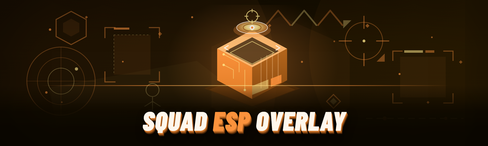

  
  
  

  

  
  
  

---

Squad ESP overlay: player/vehicle/FOBBLE box ESP, distance readout, bone snaplines, team and role colors rendered via external D3D11 overlay.

## Overview

Squad ESP overlay: player/vehicle/FOBBLE box ESP, distance readout, bone snaplines, team and role colors rendered via external D3D11 overlay.

  

## License

[MIT License](LICENSE)

  

